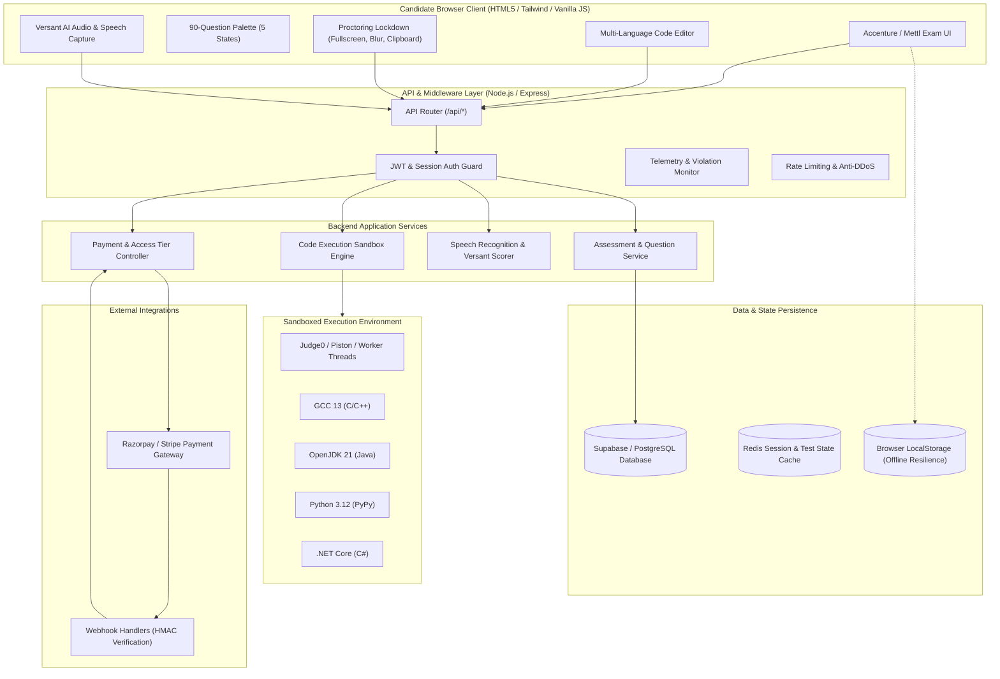
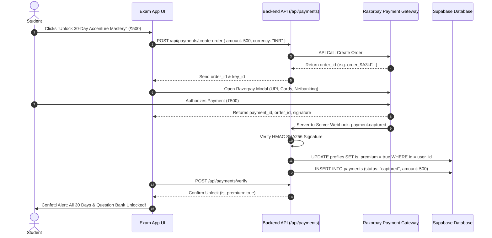

# System Architecture & Technical Design Specification
## Accenture Online Assessment (OA) Simulation & Preparation Platform

**Version:** 1.0.0  
**Target Architecture:** Full-Stack Web Platform (Zero-Dependency Node.js Local Baseline -> Scalable Production Cloud Architecture)  
**Author:** Antigravity Architecture & Engineering Team  
**Status:** Approved for Implementation  

---

## 1. High-Level Architecture Diagram



---

## 2. Database Schema (PostgreSQL / Supabase)

The database models candidate profiles, monetization access tiers, question banks, scheduled daily practice, and detailed proctoring logs.

```sql
-- 1. Profiles & Monetization Tier
CREATE TABLE public.profiles (
    id UUID PRIMARY KEY REFERENCES auth.users(id) ON DELETE CASCADE,
    email VARCHAR(255) UNIQUE NOT NULL,
    full_name VARCHAR(150),
    target_role VARCHAR(50) DEFAULT 'ASE', -- 'ASE' or 'AASE'
    is_premium BOOLEAN DEFAULT FALSE,
    premium_unlocked_at TIMESTAMP WITH TIME ZONE,
    payment_reference VARCHAR(100),
    created_at TIMESTAMP WITH TIME ZONE DEFAULT NOW(),
    updated_at TIMESTAMP WITH TIME ZONE DEFAULT NOW()
);

-- 2. Payments & Transaction Ledger
CREATE TABLE public.payments (
    id UUID PRIMARY KEY DEFAULT gen_random_uuid(),
    user_id UUID REFERENCES public.profiles(id) ON DELETE CASCADE,
    order_id VARCHAR(100) UNIQUE NOT NULL,
    payment_id VARCHAR(100) UNIQUE,
    amount_inr NUMERIC(10, 2) NOT NULL DEFAULT 500.00,
    currency VARCHAR(10) DEFAULT 'INR',
    status VARCHAR(50) NOT NULL, -- 'created', 'authorized', 'captured', 'failed'
    signature VARCHAR(255),
    raw_webhook_payload JSONB,
    created_at TIMESTAMP WITH TIME ZONE DEFAULT NOW()
);

-- 3. Master Question Bank
CREATE TABLE public.questions (
    id UUID PRIMARY KEY DEFAULT gen_random_uuid(),
    day_number INTEGER NOT NULL, -- 1 to 30
    section_category VARCHAR(100) NOT NULL, 
    -- 'english', 'critical_thinking', 'abstract_reasoning', 'common_applications', 'pseudocode', 'networking_cloud', 'coding', 'communication'
    title VARCHAR(255) NOT NULL,
    difficulty VARCHAR(20) NOT NULL, -- 'Easy', 'Medium', 'Hard'
    question_text TEXT NOT NULL,
    options JSONB, -- For MCQs: [{"id": "A", "text": "..."}, {"id": "B", "text": "..."}]
    correct_option VARCHAR(10), -- 'A', 'B', 'C', 'D'
    explanation TEXT,
    code_starter JSONB, -- For coding: {"python": "...", "java": "...", "cpp": "..."}
    test_cases JSONB, -- [{"input": "...", "expected": "...", "is_hidden": false}]
    time_limit_seconds INTEGER DEFAULT 60,
    created_at TIMESTAMP WITH TIME ZONE DEFAULT NOW()
);

-- 4. Candidate Assessment Sessions
CREATE TABLE public.assessment_sessions (
    id UUID PRIMARY KEY DEFAULT gen_random_uuid(),
    user_id UUID REFERENCES public.profiles(id) ON DELETE CASCADE,
    assessment_type VARCHAR(50) NOT NULL, -- 'daily_practice', 'full_mock_90', 'coding_round_45', 'versant_communication'
    status VARCHAR(50) DEFAULT 'in_progress', -- 'in_progress', 'submitted', 'abandoned', 'terminated'
    started_at TIMESTAMP WITH TIME ZONE DEFAULT NOW(),
    submitted_at TIMESTAMP WITH TIME ZONE,
    total_time_spent_seconds INTEGER DEFAULT 0,
    score_cognitive NUMERIC(5,2) DEFAULT 0,
    score_technical NUMERIC(5,2) DEFAULT 0,
    score_coding NUMERIC(5,2) DEFAULT 0,
    score_communication NUMERIC(5,2) DEFAULT 0,
    is_passed BOOLEAN DEFAULT FALSE,
    answers_state JSONB -- Detailed answer selections and bookmarks
);

-- 5. Proctoring Violations Telemetry
CREATE TABLE public.proctoring_logs (
    id UUID PRIMARY KEY DEFAULT gen_random_uuid(),
    session_id UUID REFERENCES public.assessment_sessions(id) ON DELETE CASCADE,
    user_id UUID REFERENCES public.profiles(id) ON DELETE CASCADE,
    violation_type VARCHAR(50) NOT NULL, -- 'tab_switch', 'window_blur', 'fullscreen_exit', 'clipboard_attempt', 'multiple_faces', 'no_face'
    violation_count INTEGER NOT NULL,
    details TEXT,
    timestamp TIMESTAMP WITH TIME ZONE DEFAULT NOW()
);
```

---

## 3. Sandboxed Multi-Language Code Compiler Engine

To evaluate candidate coding problems across C, C++, Java, Python, and C#, the platform implements a dual-tier execution architecture:

```
[Candidate Code Editor]
          |
          | POST /api/compiler/execute
          v
[Compiler Service Controller]
          |
    +-----+-------------------------------+
    |                                     |
    v (Local Development / Low Latency)   v (Production Scaled Sandboxing)
[Client / Worker Runner]             [Isolated Docker / Judge0 Microservice]
- Python: Pyodide / Worker           - Piston / Judge0 API Container
- JS / Node: Isolated VM Context     - Resource Quotas: 
                                       * CPU: 1 Core Max
                                       * Memory: 256 MB Max
                                       * Timeout: 3.0 Seconds Kill Switch
                                       * Network: Disabled (No outbound sockets)
```

### Test Case Runner Algorithm
1. Retrieve candidate source code, target language ID, and question identifier.
2. Fetch test case array (Visible Public Cases + Comprehensive Hidden Cases).
3. Execute source code against each input string via standard input (`stdin`).
4. Read standard output (`stdout`) and trim trailing whitespace/newlines.
5. Compare actual output against expected output string.
6. Track execution status:
   - `SUCCESS`: Correct match.
   - `WRONG_ANSWER`: Output mismatch (shows expected vs actual diff for public cases only).
   - `TIME_LIMIT_EXCEEDED`: Process terminated after exceeding 3,000 ms.
   - `MEMORY_LIMIT_EXCEEDED`: Exceeded 256 MB heap.
   - `COMPILATION_ERROR`: Syntax error or missing imports.
   - `RUNTIME_ERROR`: Unhandled exception or segmentation fault.
7. Return granular score and badge: `Passed X of Y test cases`.

---

## 4. Proctoring & Anti-Cheat Lockdown Engine

To simulate real enterprise platforms (HirePro / Mercer Mettl), the client attaches hardware and DOM security listeners:

```javascript
// Proctoring Enforcement Specification
const ProctoringEngine = {
  maxViolationsAllowed: 3,
  violationCount: 0,

  initialize() {
    this.enforceFullscreen();
    this.interceptClipboard();
    this.detectTabSwitch();
  },

  detectTabSwitch() {
    document.addEventListener("visibilitychange", () => {
      if (document.hidden) {
        this.recordViolation("Tab Switch Detected");
      }
    });

    window.addEventListener("blur", () => {
      this.recordViolation("Window Focus Lost");
    });
  },

  interceptClipboard() {
    const blockEvent = (e) => {
      e.preventDefault();
      showToast("Proctoring Alert: Copying, Pasting and Cutting are disabled in Accenture OA.");
    };
    document.addEventListener("copy", blockEvent);
    document.addEventListener("paste", blockEvent);
    document.addEventListener("cut", blockEvent);
    document.addEventListener("contextmenu", (e) => e.preventDefault());
  },

  enforceFullscreen() {
    document.addEventListener("fullscreenchange", () => {
      if (!document.fullscreenElement) {
        this.recordViolation("Exited Fullscreen Mode");
      }
    });
  },

  recordViolation(reason) {
    this.violationCount++;
    playWarningSound();
    logViolationToBackend({ reason, count: this.violationCount });
    if (this.violationCount >= this.maxViolationsAllowed) {
      terminateExamDueToViolation();
    } else {
      showWarningModal(this.violationCount, this.maxViolationsAllowed, reason);
    }
  }
};
```

---

## 5. Monetization & Payment Architecture (₹500 Unlock)



---

## 6. API Route Contracts

### 6.1 Authentication & Profiles
- `POST /api/auth/register` - Create student account (email, password, name, target role).
- `POST /api/auth/login` - Authenticate student and issue JWT token.
- `GET /api/auth/me` - Retrieve current session and subscription status (`is_premium`).

### 6.2 Assessment Engine
- `GET /api/assessments/schedule` - Get 30-day curriculum roadmap and completion badges.
- `POST /api/assessments/start` - Initialize exam session (Day X or Full Mock).
- `POST /api/assessments/:sessionId/save-progress` - Save candidate answer states periodically.
- `POST /api/assessments/:sessionId/submit` - Finalize test, grade MCQs, calculate sectional percentiles.
- `GET /api/assessments/:sessionId/report` - Generate detailed diagnostic scorecard.

### 6.3 Code Execution Sandbox
- `POST /api/compiler/run` - Compile and execute code against public test cases.
- `POST /api/compiler/submit` - Compile and evaluate code against all hidden test cases.

### 6.4 Versant Audio Simulator
- `GET /api/communication/prompts/:sectionId` - Retrieve audio text/synthesized speech prompt.
- `POST /api/communication/evaluate` - Transcribe candidate voice recording and calculate fluency/accuracy score.

### 6.5 Monetization & Access
- `POST /api/payments/create-order` - Generate Razorpay order for INR 500.
- `POST /api/payments/verify` - Client-side payment confirmation.
- `POST /api/payments/webhook` - Cryptographically verified payment capture webhook.
