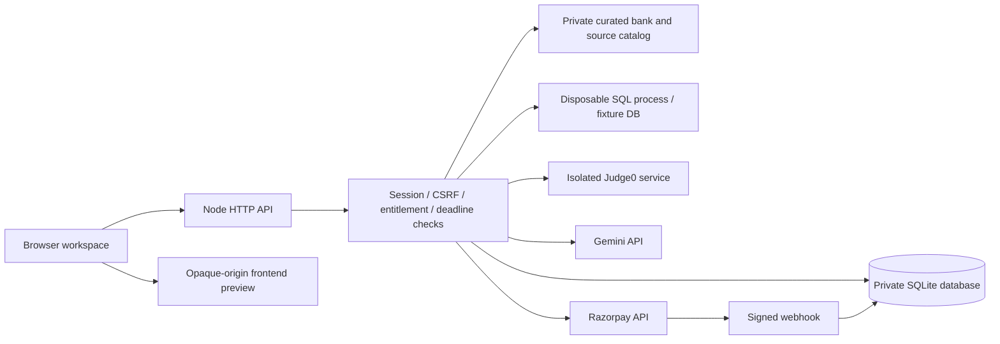

# Current implementation architecture

The original architecture proposal is preserved in the source library as `project-architecture.txt`. This file describes the implemented application as of 29 October 2026.

`server.js` loads `.env` and starts the server. `server/app.js` owns routing, input validation, authorization, integrations and static allow-listing. `server/db.js` creates the SQLite schema. `server/sql-process.js` evaluates permitted read-only queries in an independently killable process with no account DB handle or application secrets.

`public/js/app.js` renders the preparation product, auth/checkout dialogs, source library, mentor and communication practice. `public/js/ide.js` owns timed attempts, answer/code persistence, the local syntax editor and sandbox feedback. Only explicitly listed frontend assets are served. Source packs, solution code, hidden test cases, the database and `.env` are not static routes.

## State and trust boundaries

- Account identity comes from a random session token stored as a hash, never an email or user ID supplied in a request body. A server-issued device cookie is hashed and bound to the session.
- Account/payment/session state is authoritative in SQLite. All statements use bound parameters; unauthenticated paths cannot list candidate records.
- A second valid login from another active browser starts an escalating temporary cooldown. Invalid credentials cannot lock an account through the device-conflict rule. Expiry and logout permit legitimate replacement.
- One active attempt per user is enforced by a partial unique database index. Its question set, start time, expiry, owner and status are server-owned. Expired attempts reject edits and execution; submitting them uses previously saved answers.
- MCQ keys and hidden test inputs stay private. Public samples and required SQL schemas are supplied only after account and question-access checks. Browser-submitted score claims are ignored.
- A practice solution is released after server elapsed time reaches 20 minutes. This is elapsed time, not a verified measure of active attention. Mocks do not expose solution endpoints.
- Frontend code runs in an iframe with `sandbox="allow-scripts"` and a response CSP sandbox, without `allow-same-origin`. It cannot read the parent DOM/session; fetch/resource connections and forms are restricted. Browser feedback is always advisory, because a student controls their own code and browser. Heavy/infinite browser scripts still require browser-level termination; do not treat this as a production CPU sandbox.
- SQL queries run against synthetic fixtures only. The child process permits SELECT/read actions and a small built-in function list; extensions, attachment, writes and recursion are denied. Result size is limited and the process is killed after two seconds. Apply host/container quotas as an additional production boundary for native allocations.
- General-purpose submitted code goes only to the configured runner, with fixed language IDs and enforced execution limits. The app never shells out to a local compiler or evaluates student JavaScript in Node.
- Gemini gets bounded messages and selected question context, not candidate tables, payment data or secrets. Its output never grants access or determines a verified score. Active timed mocks block AI calls.
- Payment capture requires a stored user-owned order, correct callback signature and verified provider response for 49900 INR paise. Signed webhooks reconcile capture and full refunds; event IDs are deduplicated.

## Operational scope

This is a persistent single-instance Node/SQLite application. Separate Judge0 infrastructure, payment/AI credentials, a public HTTPS host, email verification/recovery and real operational support are external configuration, not simulated capabilities. All secrets belong on the server. For horizontal scale, move the database, quotas, preview handles and session coordination to shared services with transactional consistency.
